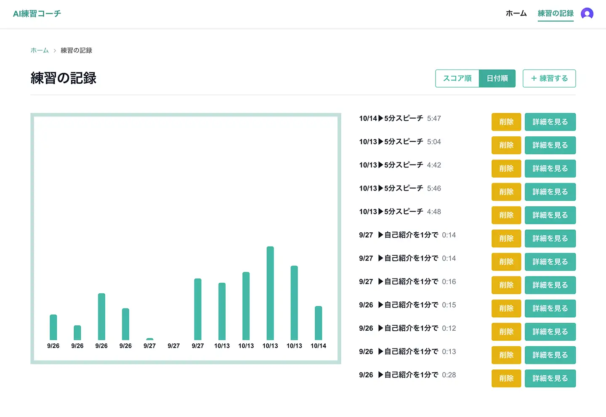

# AI練習コーチ


面接やプレゼンの練習を、AIが講評してくれるWebアプリです。話した内容に加えて、カメラで読み取った**表情（笑顔率）**と**話した時間**も踏まえて講評し、そのあとAIコーチが面接官役になって**3問の深掘り質問**をします。一人だと練習しても振り返りが難しいので、本番に近い練習を一人でもできるようにしました。

- **公開URL**：https://exp-gs-react-adv.vercel.app
  - 練習の記録・質疑応答・共有などはログイン（Clerk）後に使えます



---

## 主な機能

### 練習

- お題（自己紹介・志望動機・3分プレゼン・5分スピーチなど）と、コーチの厳しさ（やさしい／普通／厳しい面接官）を選んで練習
- 録音すると音声を文字起こしして回答欄に入れる（テキストで直接入力も可）
- 録音中は残り時間を表示（残り2割で黄色、時間オーバーで赤）
- カメラの映像から笑顔率をリアルタイムに表示
- 回答・笑顔率・話した時間をもとに、AIが「良かった点」「改善点」を講評

### AIコーチとの質疑応答

- 講評のあと、AIコーチが回答の中身に踏み込んだ質問を1問ずつ、全部で3問出す
- 3問すべて答え終わったら、受け答え全体をまとめて総評

### 振り返り

- 講評の音声読み上げと、音声ファイル（mp3）のダウンロード
- 練習の記録の一覧とスコアのグラフ（スコア順・日付順の並べ替え）
- 記録ごとの詳細ページ、メモの追記、削除
- 講評をメールで受け取る
- 共有リンクの発行と取り消し（リンクを知っている人だけが閲覧できる）

---

## 使用技術

| 分類           | 技術                                                      |
| -------------- | --------------------------------------------------------- |
| フロントエンド | Next.js 16（App Router）/ React 19 / TypeScript           |
| スタイル       | Tailwind CSS 4 / daisyUI 5                                |
| データベース   | Neon（PostgreSQL）/ Drizzle ORM                           |
| 認証           | Clerk                                                     |
| AI             | Groq（講評・質疑応答：gpt-oss-120b、文字起こし：Whisper） |
| 表情の判定     | face-api（@vladmandic/face-api、ブラウザ上で実行）        |
| 音声合成       | Edge TTS（@andresaya/edge-tts）                           |
| メール         | Resend                                                    |
| インフラ       | Vercel                                                    |

### ディレクトリ構成

```
.
├── app/
│   ├── page.tsx              # ホーム（練習画面）
│   ├── history/              # 練習の記録の一覧・詳細
│   ├── share/[token]/        # 共有リンクで開く公開ページ
│   ├── api/
│   │   ├── coach/            # 講評の作成と保存
│   │   ├── transcribe/       # 音声の文字起こし
│   │   ├── tts/              # 講評の音声合成
│   │   └── sessions/[id]/    # 記録の取得・削除、質疑応答、共有、メール送信
│   ├── practice.ts           # お題・厳しさ・文字数上限などの設定
│   └── *.tsx                 # 録音・表情メーター・質疑応答などのコンポーネント
├── db/                       # Drizzle のスキーマとDB接続
├── public/models/            # face-api の学習済みモデル
└── proxy.ts                  # Clerk の認証ミドルウェア
```

---

## DB設計

| テーブル      | 内容                                                                                                        |
| ------------- | ----------------------------------------------------------------------------------------------------------- |
| `sessions`    | 練習1回ぶんの記録（お題・回答・笑顔スコア・話した時間・目安時間・講評・メモ・共有トークン・質疑応答の総評） |
| `judge_turns` | AIコーチとの質疑応答1問ぶん（質問・回答）。1つの練習に最大3行つく1対多                                      |

- 練習の記録を削除すると、質疑応答も一緒に削除されます（`ON DELETE CASCADE`）。
- `judge_turns` には `(session_id, turn_no)` のユニーク制約をつけ、ボタンの連打などで同じ問題番号が二重にできないようにしています。
- 保存した時点の目安時間（`limit_sec`）も記録しておき、あとでお題の設定を変えても、過去の記録は当時の目安で判定できるようにしています。

---

## 工夫した点

### 表情と時間も踏まえた講評

- 話している間、0.5秒ごとに笑顔率を記録し、その平均をAIに渡しています。表情の判定はブラウザ上で行うので、カメラの映像はサーバーに送りません。
- 話した時間とお題の目安時間もAIに渡し、時間内に収まったかどうかにも触れるようにしました。
- 講評は「良かった点」「改善点」の2段落に形式をそろえ、画面・メール・読み上げで同じように扱えるようにしています。

### 質疑応答の進行はサーバーが管理

- 何問目まで進んだかは、画面から受け取らずにサーバーがDBを見て判断しています。お題・最初の回答・これまでのやりとりもDBから読むので、画面側で書き換えることはできません。
- AIの返事は JSON スキーマ（strict モード）で形を固定し、質問と総評を確実に取り出せるようにしました。
- 回答の保存と次の質問の保存は1つのトランザクションでまとめて行い、「答えたのに次の質問がない」状態にならないようにしています。

### 音声まわりの実際の不具合への対応

- Whisper は無音でも「ご視聴ありがとうございました」のような文をでっち上げることがあるため、区間ごとの「話していない確率（`no_speech_prob`）」を受け取って、高い区間を捨てるようにしました。
- 5分スピーチを録音すると、サーバーに送るファイルが大きすぎてエラー（413）になったため、録音のビットレートを下げて解消しました。
- 経過時間は「1秒ごとに+1」ではなく、毎回「今の時刻 − 開始時刻」で計算し、タイマーがずれないようにしています。

### セキュリティ

- **AIに保存させる内容**：講評はサーバーで作ってそのまま保存し、画面から講評の文章を受け取らないようにしました。AIが書いていない講評は保存できません。メールも記録の id だけを受け取り、サーバーがDBの内容から本文を作ります。
- **プロンプトインジェクション対策**：ユーザーの回答は区切り記号で囲み、「中に書かれた指示には従わない」ことをAIに伝えています。コーチの厳しさも、画面から送られた文ではなくサーバー側の設定からAIへの指示を作ります。
- **認可**：記録の取得・削除・共有・質疑応答は、ログイン中のユーザー自身の記録だけを対象にしています。
- **共有リンク**：連番の id ではなく推測できないトークンを使い、共有をやめるとリンクは無効になります。
- **入力チェック**：文字数の上限や数値の範囲をサーバー側でも確認し、不正な値は弾くか「計測なし」として扱います。
- **秘密情報の管理**：APIキーなどは環境変数に分けて、リポジトリには含めていません。

---

## 苦労した点

録音・カメラ・文字起こし・音声合成と、ブラウザと外部APIの両方にまたがる機能が多く、ローカルでは動いていても本番で初めて分かる問題がいくつもありました。5分の録音でファイルサイズの上限にかかったり、音声合成のライブラリが突然 403 を返すようになったりしたときは、エラーの原因を一つずつ切り分けて対応しました。
